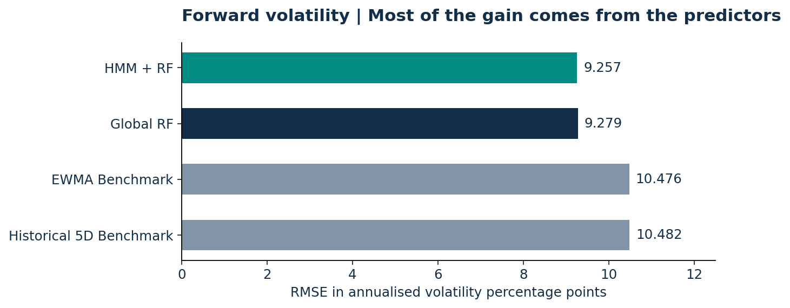

# HMM Regime-Aware Volatility Forecasting
### From hidden-state inference to a genuine forward prediction target

**Question:** Does separating low- and high-volatility regimes improve forecasts of NIFTY 50 volatility over the next five trading days?

**Finding:** HMM plus random forests reduced daily-test RMSE by **11.69%** against a historical five-day-volatility forecast. Its improvement over a global random forest was only **0.23%** and reversed in the non-overlapping weekly check. The predictors help; a decisive incremental benefit from regime separation is not established.



| Model | Daily-test RMSE | Non-overlapping RMSE |
|---|---:|---:|
| HMM + random forests | **9.2569** | 8.6131 |
| Global random forest | 9.2787 | **8.6061** |
| Historical 5-day volatility | 10.4825 | 9.4629 |
| EWMA volatility | 10.4758 | 10.1721 |

Volatility and its error are measured in annualised percentage points. [Saved results](outputs_forward_5day_volatility/) · [Detailed findings](docs/RESULTS.md) · [Research notebook](HMM_Forward_5Day_Realized_Volatility.ipynb)

## Technical contribution

- A two-state lognormal HMM implemented from scratch using forward–backward inference and Baum–Welch estimation.
- Causal filtered state probabilities, with the HMM fitted on the training block.
- A five-day **future realised volatility** target, rather than tomorrow's largely overlapping historical statistic.
- Regime-specific random forests compared with a global forest and two simple baselines.
- A chronological 70/30 split, with training labels that end before the test boundary.
- An additional evaluation every fifth origin to remove target-window overlap.

## Run it

Python 3.10+; use the repository root as the working directory.

```bash
python -m pip install -r requirements.txt
python scripts/run_analysis.py
```

The script uses the included historical `nifty50_prices.csv` and writes tables under `outputs_forward_5day_volatility/`. For the narrated version, open the notebook in Jupyter and run cells in order. The CSV supplies an offline snapshot; the notebook's Yahoo download path is a fallback, not a promise that future downloads reproduce the same data vintage.

## Interpretation

The HMM provides interpretable persistent states, with higher forecast error during high volatility. But the global-forest control is nearly as accurate. One index and one static chronological split do not establish broad market robustness or trading profitability. Walk-forward re-estimation and wider asset coverage are natural follow-up experiments.

[Full methods and result tables](docs/RESULTS.md) · [Portfolio](https://github.com/Fakhruddin12)  
**Author:** Fakhruddin Hakim Hussain
